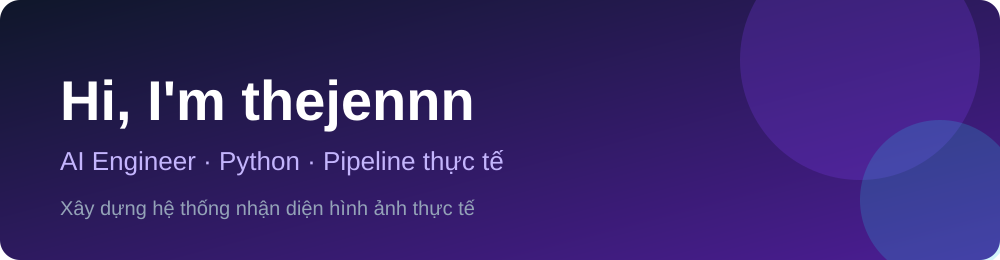

  

Xin chào, mình là **thejennn**, một **AI Engineer** chuyên biến những mô hình AI từ "chạy được trong notebook" thành thứ có thể đem ra webcam và bị thử thách thật sự.

Mình làm cả chuỗi: huấn luyện model, ghép các model thành pipeline, rồi giơ điện thoại trước camera để xem AI có nhận ra biển báo không. Lần đầu nó nhận đúng biển "Cấm quay đầu" với 97%, và mình ăn mừng như vừa thắng giải thưởng nào đó.

Mình thích những bài toán mà dữ liệu lộn xộn, người dùng thì luôn làm mọi thứ theo cách không ai lường trước. Đó là lúc AI thật sự phải làm việc. Gần đây mình làm nhận diện biển báo realtime, tóm tắt biên bản họp cùng nhóm, và một trợ lý sàng lọc nguy cơ đột quỵ.

---

## 🚀 Dự án nổi bật

| Dự án | Mô tả | Công nghệ |
|---|---|---|
| [Traffic-sign-classification](https://github.com/thejennn/Traffic-sign-classification) | Nhận diện biển báo giao thông Việt Nam bằng YOLO và CNN, chạy trên ảnh và webcam | Python, YOLO, TensorFlow |
| [Verba](https://github.com/Biggbros/Verba-AI-Meeting-Recognition) | Quản lý biên bản cuộc họp bằng AI: chuyển giọng nói thành văn bản, tóm tắt và xuất tài liệu (nhóm Biggbros) | Full-stack, AI |
| [StrokeGuard AI](https://github.com/NhatBang1/Healthcare-Stroke-prediction) | Trợ lý sàng lọc nguy cơ đột quỵ từ hồ sơ sức khỏe, kết hợp mô hình lâm sàng và LLM | Python, PostgreSQL, LLM |

---

## 🛠️ Kỹ năng

<table>
  <tr>
    <td valign="top" width="50%">

**🧠 AI & Học sâu**
 

    </td>
    <td valign="top" width="50%">

**🗄️ Dữ liệu & Công cụ**
 

    </td>
  </tr>
</table>

---

## 📊 Thống kê

  
  

  <picture>
    <source media="(prefers-color-scheme: dark)" srcset="https://raw.githubusercontent.com/thejennn/thejennn/output/snake-dark.svg" />
    
  </picture>

---

Cảm ơn bạn đã ghé thăm! ⭐

